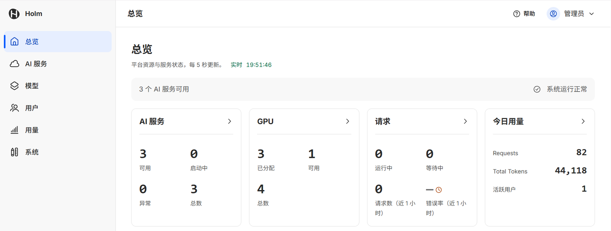
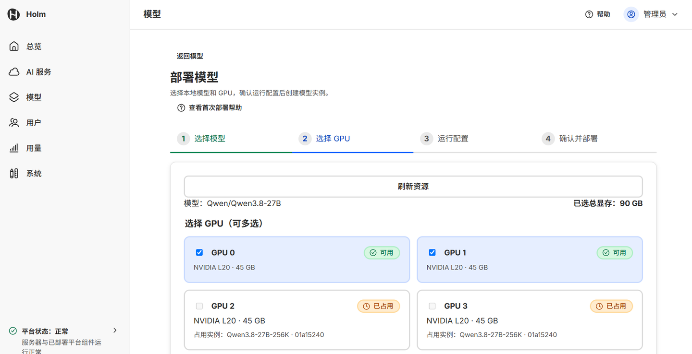
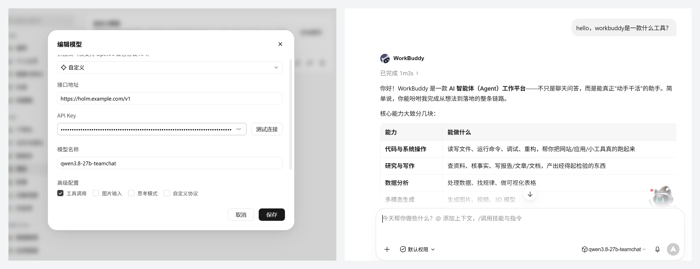

<div align="center">

<picture>
  <source media="(prefers-color-scheme: dark)" srcset="docs/assets/holm-mark-dark.svg">
  
</picture>

<h1>Holm</h1>

<p><strong>Turn a GPU server into your team's own private AI service platform</strong></p>

<p>
  <a href="docs/install.md">Install guide</a> ·
  <a href="#api-examples">API examples</a> ·
  <a href="#preview-limitations">Preview limitations</a> ·
  <a href="README.md">中文</a>
</p>

<p>
  <a href="LICENSE"></a>
  
  
</p>

</div>

Admins download models, deploy them onto GPUs, publish them as AI services and grant access from a web console; members call them with their own API keys through OpenAI- or Anthropic-compatible APIs, so tools like Claude Code connect directly.

> [!NOTE]
> v0.1.0-rc.1 is a preview release for evaluation in test environments. The web console, install guide and in-product help are currently in Chinese only.

## Features

- **Models**: download from Hugging Face or ModelScope with pause and resume, or register a model directory already on the server for read-only use.
- **Deployment**: deploy onto chosen GPUs with vLLM or SGLang, including multi-GPU tensor parallelism.
- **AI services**: publish a model behind one stable endpoint; swapping the backing instance is invisible to callers.
- **Users and keys**: per-service grants; keys are shown only once at creation, can expire and can be revoked.
- **Rate limits**: concurrent requests and requests per minute per user × service.
- **Compatible APIs**: OpenAI (`/v1/chat/completions` and more) and Anthropic (`/v1/messages`), with streaming, tool calls and reasoning.
- **Usage and monitoring**: request records, token usage statistics, GPU and service monitoring.
- **Privacy**: request and response bodies exist only in memory while being forwarded and are never written to disk; request records keep only metadata and token counts.

## Screenshots

<p align="center"></p>
<p align="center"><sub>Overview: AI services, GPUs, requests and today's usage</sub></p>

<p align="center"></p>
<p align="center"><sub>Deploy a model: pick GPUs, multi-GPU supported</sub></p>

<p align="center"></p>
<p align="center"><sub>An AI coding assistant on your private model (WorkBuddy)</sub></p>

## How it differs from Ollama

| | Ollama | Holm |
|---|---|---|
| For | Individuals, on their own computer | Teams sharing one GPU server |
| Inference engine | llama.cpp, mostly GGUF quantized models | vLLM / SGLang, original weights, higher throughput under concurrent use |
| Multiple users | Callers are not distinguished | One key per person, with grants, rate limits and usage statistics |
| Management | Command line | Web console |
| Platforms | macOS, Windows, Linux, CPU-only works | Linux + NVIDIA GPU only |

They work well together: Ollama for trying models on your own machine, Holm for sharing them with a team.

## Quick start

**Requirements**: Ubuntu Server 22.04 / 24.04, NVIDIA driver ≥ `580.65.06`, Docker with the NVIDIA Container Toolkit, Python 3.12, and at least 80 GiB of free disk space.

The installer command is `holm`: before installation it lives at `deploy/installer/holm` in the repository, afterwards at `/opt/holm/holm`. Both build and install must be run with Python 3.12.

```bash
git clone https://github.com/whisper-wind17/holm.git && cd holm
sudo python3.12 deploy/build/holm-build --public-url https://<host>
sudo python3.12 deploy/installer/holm install --config build/release/install.json
```

When installation finishes, the terminal prints an initialization link. Open it **within 30 minutes** to set up the admin account.

**Install with an AI coding assistant**: open Claude Code, Codex or a similar assistant on the server and send the message below. The assistant checks the environment, confirms parameters with you, then installs step by step; you read the initialization token yourself, it never passes through the assistant.

```text
Clone https://github.com/whisper-wind17/holm.git, read docs/install.md in the repository in full, strictly follow its "给 AI 助手的规则" (rules for AI assistants) section, and help me install Holm on this server.
```

> [!TIP]
> The default is an internal certificate, so clients must trust its root certificate first. Certificate modes, build options, client setup and uninstalling are covered in the [install guide](docs/install.md) (Chinese).

## API examples

After an admin publishes a service and grants access, members find the endpoint and model name on their service detail page and create an API key there.

**OpenAI-compatible** (the base URL ends at `/v1`)

```bash
curl https://<host>/v1/chat/completions \
  -H "Authorization: Bearer $HOLM_API_KEY" \
  -H "Content-Type: application/json" \
  -d '{"model": "<model-name>", "messages": [{"role": "user", "content": "Hello"}]}'
```

**Anthropic-compatible** (Claude Code as an example)

```bash
export ANTHROPIC_BASE_URL=https://<host>
export ANTHROPIC_API_KEY=$HOLM_API_KEY
export ANTHROPIC_MODEL=<model-name>
claude
```

## Preview limitations

- Single server only; GPUs are allocated whole, so models cannot share a GPU.
- API only, no chat UI; no multimodal input.
- Rate limits cover concurrency and requests per minute only; no token quotas.
- `holm uninstall` is the only operations command so far; `status`, `logs` and `doctor` are planned for later releases.
- Not yet verified: real ACME issuance and renewal, full verification of the internal certificate mode, offline install, upgrade and rollback, SBOM and signing, security hardening scan, accessibility review.
- Hardware verification has been done on NVIDIA L20 only; both vLLM and SGLang have been verified end to end with deployment and chat.

## Documentation

| Document | Contents |
|---|---|
| [Install guide](docs/install.md) (Chinese) | Requirements, build options, TLS certificates, client trust, uninstalling |
| [Changelog](CHANGELOG.md) (Chinese) | New features, fixes and known limitations by release |

## Contributing

A single repository with Python (uv workspace) and TypeScript (`apps/web`), driven by one entry point, `./dev`:

```bash
./dev bootstrap    # install dependencies: uv ≥ 0.11, Node ^22.13 or 24, npm 10–11
./dev fast-check   # formatting, lint, type checks, unit tests
./dev ci           # full check: adds integration and fault tests
```

Main directories: `apps/` (Control API, Gateway, Workers, Host Agent, Web), `packages/` (domain, contracts, persistence, protocols and runtime adapters, security), `migrations/`, `deploy/`, `tests/`.

**Security issues**: please do not open a public issue; report privately via "Report a vulnerability" on the repository's Security page.

## License

[Apache License 2.0](LICENSE). Third-party dependencies and the fonts and vocabulary files shipped in the repository keep their own licenses; see [THIRD_PARTY_LICENSES.md](THIRD_PARTY_LICENSES.md).
